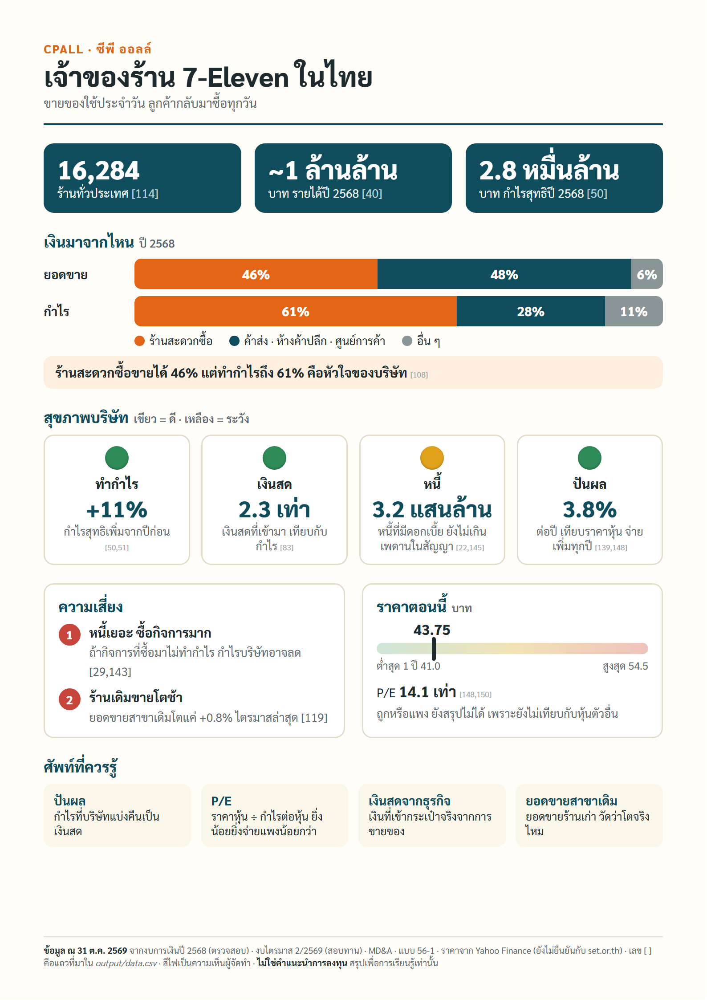
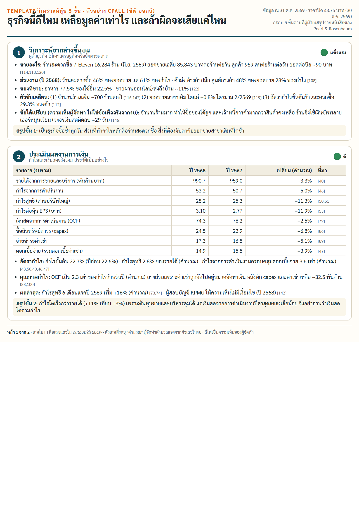
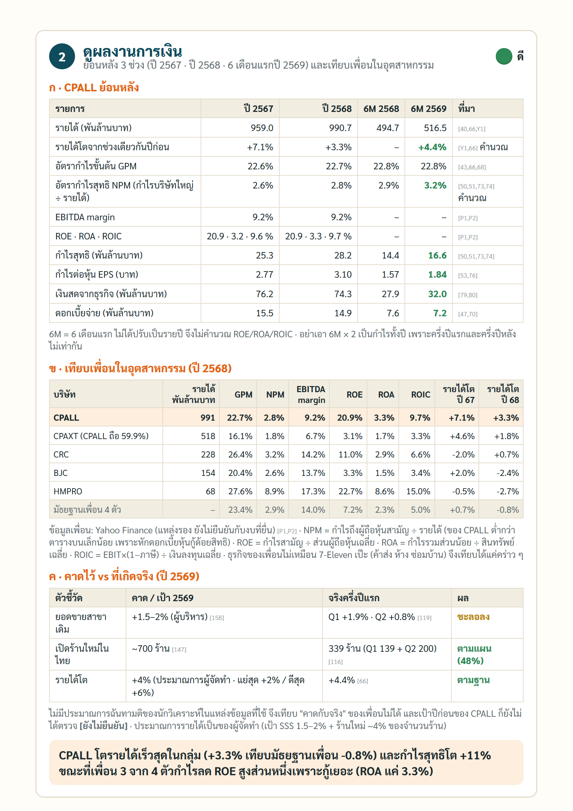
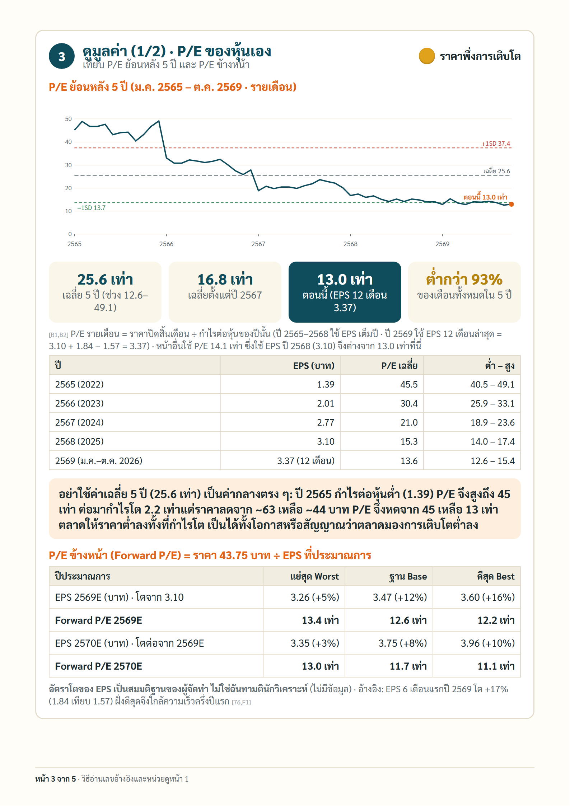
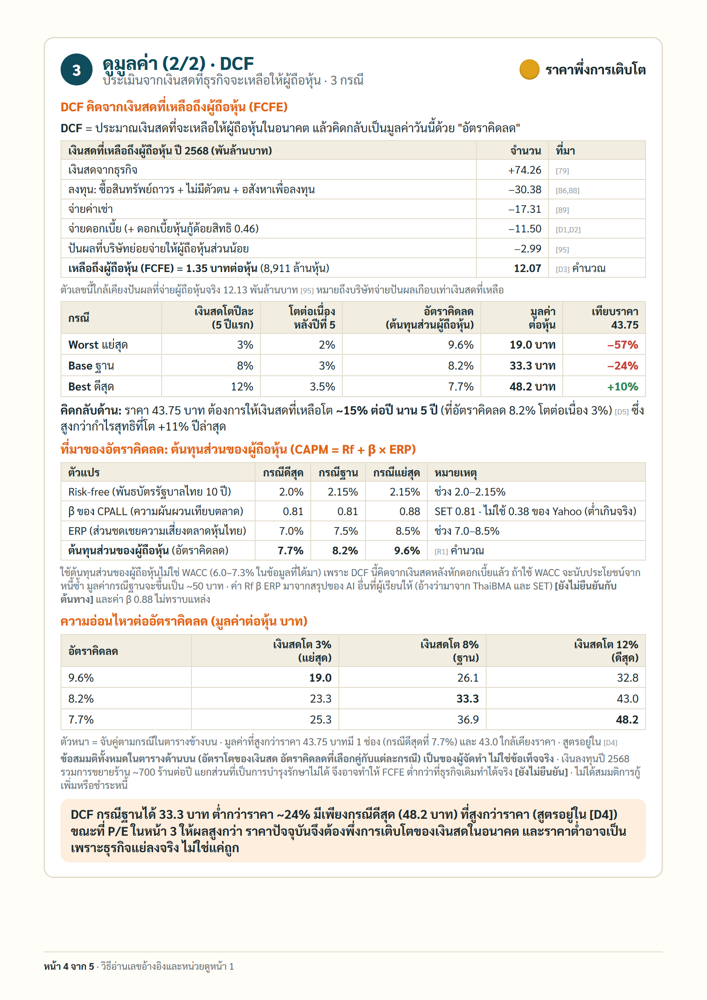
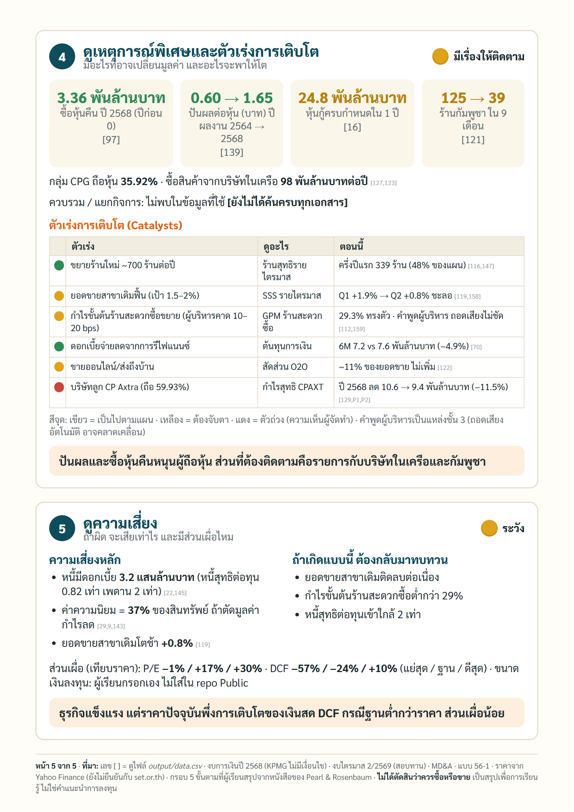

# Stock One-Pager · สรุปหุ้น 1 หน้า อ่านเข้าใจใน 3 นาที

> การบ้าน AI Investor Alpha · Day 1 → Day 2

| | |
|---|---|
| **ชื่อเล่น** | Summ |
| **กลุ่ม** | g06 · สรุปหุ้นให้คนไม่เคยลงทุนเข้าใจใน 3 นาที |
| **โจทย์ 1 บรรทัด** | เปลี่ยนผลวิเคราะห์หุ้นที่ AI Agent ทำไว้ให้เป็นสรุป 1 หน้า A4 ที่คนไม่เคยลงทุนอ่านเข้าใจใน 3 นาที และมี template วิเคราะห์ 5 ขั้นใช้ซ้ำได้ |
| **ลิงก์ผลงาน** | ดูด้านล่าง หรือในโฟลเดอร์ [`output/`](output/) |
| **สถานะ** | พร้อมตรวจ (รอบ 8) · ยังไม่ได้ทดสอบอ่าน 3 นาทีกับคนไม่เคยลงทุน |

## ผลงาน (ตัวอย่างหุ้น CPALL · ข้อมูล ณ 31 ต.ค. 2569)

### 1) สรุป 1 หน้า A4 · [เปิด PDF](output/CPALL-one-pager.pdf)

### 2) Template วิเคราะห์หุ้น 5 ขั้น · [เปิด PDF](output/CPALL-5-step.pdf) · [ฟอร์มเปล่าใช้ซ้ำ](output/5-step-template.md)

กรอบ 5 ขั้นตามที่ผู้เรียนสรุปจากหนังสือ *The Little Book of Investing Like the Pros* (Pearl และ Rosenbaum): วิเคราะห์จากล่างขึ้นบน · ผลงานการเงิน · มูลค่า · เหตุการณ์พิเศษ · ความเสี่ยง

5 หน้า: (1) ภาพรวม + ดูตัวธุรกิจ · (2) ผลงานการเงินย้อนหลัง 3 ช่วง + เทียบเพื่อน + คาดไว้ vs จริง · (3) P/E ย้อนหลัง 5 ปี + Forward P/E · (4) DCF 3 กรณี · (5) เหตุการณ์พิเศษ + ตัวเร่งการเติบโต + ความเสี่ยง

**วิธีอ่านเลข `[ ]` ในทุกหน้า:** เป็นเลขอ้างอิง ชี้ไปที่แถวใน [`output/data.csv`](output/data.csv) (บอกเอกสาร หน้า/บรรทัด งวด และหน่วยเดิม) · เงินเป็นบาท (1 พันล้าน = 1,000 ล้าน) · ปี 2565–2569 = ค.ศ. 2022–2026 · 6M = 6 เดือนแรก

- ตัวเลขทุกตัวมีที่มาใน [`output/data.csv`](output/data.csv) (ตัวเลขที่คำนวณเองระบุสูตร)
- มูลค่าในขั้น 3 เป็นสมมติฐานของผู้จัดทำ ไม่ใช่ข้อเท็จจริง ราคาหุ้นมาจาก Yahoo Finance และยังไม่ยืนยันกับ set.or.th
- เอกสารนี้ใช้เพื่อการเรียนรู้ ไม่ใช่คำแนะนำการลงทุน
- ไฟล์ `.html` ใน `output/` เปิดดูในเบราว์เซอร์หลังดาวน์โหลด (GitHub ไม่แสดงผล HTML) ส่วน PDF และภาพดูบน GitHub ได้เลย

---

## Dashboard ของ CPALL

ผลวิเคราะห์ทั้งหมดรวมเป็น dashboard หน้าเดียวบน claude.ai ตามโครง Verdict · ตัวเลขหลัก · Bull · Risks · Unknowns · คำถามต่อไป (Artifact ส่วนตัว เปิดได้เฉพาะเจ้าของ ถ้าจะให้ผู้สอนดูต้องแชร์ลิงก์จากเมนู Share) ข้อมูล 11 ชุดที่ dashboard ใช้ อยู่ที่ [`output/dashboard-data/`](output/dashboard-data/) เป็นไฟล์ CSV และทุกตัวเลขมีที่มาใน [`output/data.csv`](output/data.csv) (GitHub แสดงตัว dashboard ไม่ได้ แสดงได้เฉพาะข้อมูลดิบ)

## ไฟล์ใน repo นี้

| ไฟล์ | ใส่อะไร |
|---|---|
| `spec.md` | โจทย์ของคุณ 5 หัวข้อ (หัวใจของการบ้าน) |
| `prompts.md` | บันทึกขั้นตอนทุกรอบ: ทำอะไร, prompt, ผลที่ได้, ตัดสินใจเพราะอะไร |
| `PROJECT_MEMORY.md` | ปัญหาที่เจอ, วิธีแก้, และกฎที่ได้จากบทเรียน |
| `output/` | ภาพหน้าจอ หรือลิงก์ผลงาน |
| `help.md` | ติดตรงไหน 3 ข้อ ให้ผู้สอนเตรียมคำตอบ |
| `AGENTS.md` | คำสั่งให้ AI ทุกค่ายทำงานใน repo นี้ (`CLAUDE.md` และ `GEMINI.md` ชี้มาที่ไฟล์นี้) |
| `.claude/commands/save.md` | ขั้นตอนของคำสั่ง `/save` |

## ก่อนเริ่มทำการบ้านทุกครั้ง

- [ ] เปิดโฟลเดอร์ `homework/aia-hw-…` ของคุณเป็นที่ทำงานใน Claude
- [ ] ถามว่า "ตอนนี้ทำถึงไหน" Claude ต้องตอบจาก `prompts.md` ได้ (ถ้าตอบไม่ได้ = เปิดผิดโฟลเดอร์)
- [ ] เช็ก model · effort · permission
- [ ] ดูคอมเมนต์ผู้สอนในแท็บ Issues ของ repo บน GitHub

ระหว่างทำ: เปิด Plan mode ก่อนงานใหม่ · ทำทีละรอบ · ทุกตัวเลขต้องมี source · ติดตรงไหนจดลง `help.md`

## บันทึกงานทุกรอบ: พิมพ์ `/save`

ทำงานเสร็จแต่ละรอบ ให้พิมพ์ `/save` ใน Claude (ใส่สรุปสั้น ๆ ต่อท้ายได้ เช่น `/save ร่าง spec รอบแรก`) AI จะทำให้ครบ:

1. ตรวจว่าไม่มี key หรือข้อมูลส่วนตัว
2. เพิ่มบันทึกขั้นตอนใน `prompts.md`
3. บันทึกปัญหาและบทเรียนใน `PROJECT_MEMORY.md` ถ้ามี
4. commit ด้วยข้อความ `รอบ N: ทำอะไร` แล้ว push ขึ้น GitHub

ใช้ Codex หรือ Gemini: พิมพ์ว่า `save` ได้เหมือนกัน (ขั้นตอนเดียวกัน อยู่ใน `.claude/commands/save.md`)

ถ้า commit เองหรืออัปโหลดผ่านหน้าเว็บ GitHub ให้เขียน entry ใน `prompts.md` เองตามแบบฟอร์มในไฟล์

## ไทม์ไลน์

| วัน | ทำอะไร |
|---|---|
| เสาร์ 31 ต.ค. · 17:45 | repo + spec ร่างแรก |
| **พุธ 4 พ.ย. · 21:00** | **Deadline: ส่งฉบับพร้อมตรวจ** |
| พฤ–ศ 5–6 พ.ย. | ผู้สอนคอมเมนต์ใน Issues ของ repo นี้ |
| เสาร์ 7 พ.ย. · 13:30 | Repair Clinic ในห้อง |

ส่งลิงก์ repo ครั้งเดียวในวันเรียน ผ่าน **Google Form ที่ผู้สอนแจกในห้อง (สแกน QR บนจอ)** งานที่ `/save` เพิ่มภายหลังจะอัปเดตใน repo เอง ไม่ต้องส่งซ้ำ

## ห้ามขึ้น Public

repo นี้ใครก็เปิดดูได้ ห้ามใส่สิ่งเหล่านี้เด็ดขาด

- API key · password · token · ไฟล์ `.env`
- พอร์ตจริง · จำนวนหุ้น · เลขบัญชี · ข้อมูลส่วนตัว
- ข้อมูล SETSMART ที่ซื้อมา (ไฟล์ดิบ)
- บทวิเคราะห์โบรกเกอร์ (ติดลิขสิทธิ์)

ถ้าเผลอ push key ขึ้นไปแล้ว: **เปลี่ยน key ใหม่ทันที** การลบไฟล์ทิ้งอย่างเดียวไม่พอ เพราะประวัติใน git ยังเก็บไว้

## เช็กก่อนส่ง

- [ ] repo เป็น Public และเปิดได้จากหน้าต่าง incognito
- [ ] `spec.md` ครบ 5 หัวข้อ
- [ ] `prompts.md` มีบันทึกอย่างน้อย 3 รอบ และทุก commit มี entry คู่กัน
- [ ] `PROJECT_MEMORY.md` มีปัญหาหรือบทเรียนอย่างน้อย 1 ข้อ
- [ ] `output/` มีภาพหรือลิงก์อย่างน้อย 1 ชิ้น
- [ ] `help.md` เขียนครบ 3 ข้อ
- [ ] ไม่มี key, password หรือข้อมูลพอร์ตจริงในทุกไฟล์
- [ ] ส่งลิงก์แล้ว
